<h1 align="center">Glasshouse</h1>

<p align="center">Declutter your Android TV: turn off the bloat and replace the cluttered home screen with a clean, minimal one.</p>

<p align="center">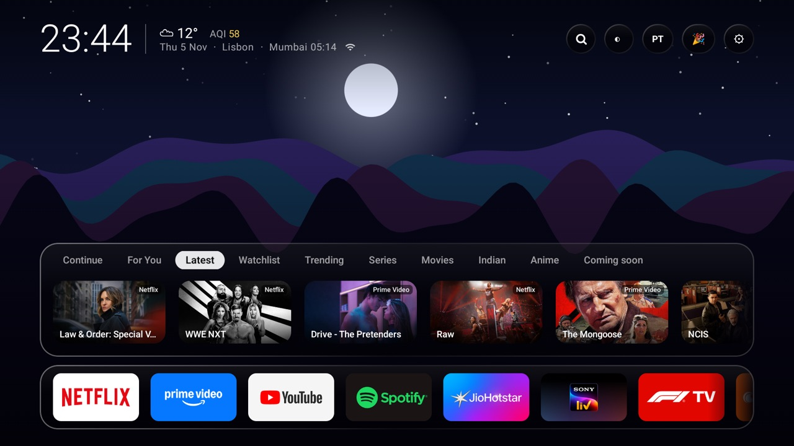</p>

Smart TVs ship with promo rows, preinstalled apps you never asked for and a home screen built to sell you things. Glasshouse does two things about that:

1. **Debloat:** a script turns off the preinstalled apps you don't want. It previews first, and everything can be switched back on.
2. **A clean home screen:** your apps, what you're watching and what to watch next. No promo rows and no account.

You build it yourself with your own free API keys, and every change to your TV can be undone. Ads inside streaming apps aren't affected.

> **Personal project, shared as is.** It's built for and tested on one Sony Bravia. There's no support and no promise of fixes. Pull requests are welcome, and forking it to suit your own TV is encouraged.

## Contents

[Debloat your TV](#debloat-your-tv) · [What you get](#what-you-get) · [Supported TVs](#supported-tvs) · [Quick start](#quick-start) · [Make it yours](#make-it-yours) · [Diwali Party](#diwali-party) · [Permissions and privacy](#permissions-and-privacy) · [Undo everything](#undo-everything) · [Contributing](#contributing) · [Credits and legal](#credits-and-legal)

## Debloat your TV

This works without the home screen, and needs only `adb` connected to your TV (step 1 and the `adb connect` line under [Quick start](#quick-start)). Windows users can run it from Git Bash.

```bash
scripts/debloat.sh                 # preview: shows what would go, changes nothing
scripts/debloat.sh --apply         # disable the tested list
scripts/debloat.sh --apply --extras  # also disable the untested list
scripts/debloat.sh --undo          # bring everything back
```

Apps are disabled, never uninstalled. Only apps found on your TV are touched, and core system apps aren't on either list.

| List | What's on it | Status |
|---|---|---|
| Tested | Sony's regional catch-up shortcuts and a few preinstalled streaming apps | Run on a Sony Bravia with no problems found |
| `--extras` | Samba TV, Sony's promo and selection apps, the app that auto-installs extras, and a few preinstalled extras | **Not tested.** These look safe to disable, but could affect a feature you use |

The lists are mostly Sony's. On other brands the script simply finds less. **Read the lists in [`scripts/debloat.sh`](scripts/debloat.sh) first** and delete anything you want to keep, such as an app you actually use. Firmware updates can turn apps back on, so run it again after one.

## What you get

| | |
|---|---|
| **Home screen** | Minimal liquid-glass design, animated wallpapers that follow the sun, clock and weather, and your apps as their own banners |
| **Discovery** | For You, Latest, Trending, Series, Movies, Anime and Coming soon, each showing which of your services carries the title |
| **Continue watching** | Picks up what you played in streaming apps. YouTube cards reopen the video where you left off |
| **Hold OK on any card** | Remove it from Continue, or never see it again |
| **Discover** | Swipe through titles to teach For You what you like |
| **Jarvis** | Ask for "funny shows like Panchayat", or tell it to open apps, set a sleep timer or change the lights. Uses Gemini's free tier |
| **Phone remote** | Open a page on your phone to type, control the TV and launch apps, protected by a PIN |
| **Extras** | F1 and F2 calendar and standings, Govee lights, a screensaver, night mode, and volume remembered per app |

<p align="center">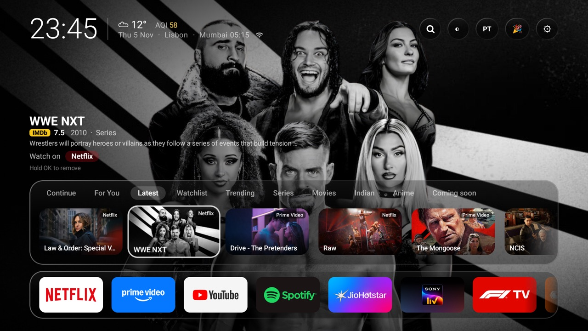</p>

## Supported TVs

| TV | Status |
|---|---|
| Sony Bravia, Android TV 12 | **Tested.** This is the only TV it has run on |
| Other Android TV or Google TV on Android 12+ (API 31+) | Should work, but untested. Remote shortcut buttons and the mic may behave differently |
| Android TV below Android 12, including most older sets | Not supported: the app requires API 31 |
| Fire TV, Samsung (Tizen), LG (webOS), Roku, Apple TV | Not possible: they don't run Android TV apps or allow a custom home screen in this way |

Check your version under Settings → System → About.

## Quick start

You need [Android Studio](https://developer.android.com/studio) (for the SDK and `adb`), JDK 17, and a free [TMDB API key](https://www.themoviedb.org/settings/api). It's built and tested on macOS. The Gradle wrapper also supports Windows, though that route hasn't been tried.

**1. Enable network debugging on the TV.** Settings → System → About → press Build 7 times, then Developer options → Network debugging. Note the TV's IP address.

**2. Get the code and add your keys.**

```bash
git clone https://github.com/nishchitm/Glasshouse.git
cd Glasshouse
cp local.properties.example local.properties
cp glasshouse.properties.example glasshouse.properties
```

On Windows, use `copy` instead of `cp`. Then edit both files. Only `sdk.dir` and `tmdb.apiKey` are required.

**3. Build and install.**

```bash
adb connect YOUR-TV-IP:5555
./gradlew assembleRelease
adb install -r app/build/outputs/apk/release/app-release.apk
adb shell cmd package compile -m speed -f com.cleantv.launcher
```

On Windows, use `gradlew.bat assembleRelease`. The last line makes the interface noticeably smoother, so run it after every install. The TV asks you to allow debugging the first time you connect.

The release build is signed with the debug key, which is fine for your own TV but not for the Play Store.

**4. Make it your home screen.**

```bash
adb shell cmd package set-home-activity com.cleantv.launcher/.HomeAlias
```

Or run `scripts/set-default-launcher.sh` (Git Bash on Windows). Some firmware ignores this and returns to Google TV; the script's `--disable-google-tv` option handles that. **That option once made a test TV forget its Wi-Fi**, so have your password handy.

**5. Debloat, if you haven't.** See [Debloat your TV](#debloat-your-tv).

**6. Turn on the optional parts.** Press the remote's settings button in Glasshouse to open Quick settings, which prompts you to allow:
- **Glasshouse remote buttons** (accessibility): the settings button, mic button and app shortcut
- **Glasshouse Continue watching** (notification access): Continue watching and the party music controls

Don't force-stop Glasshouse, because Android turns the accessibility service off when you do.

## Make it yours

All of this lives in `glasshouse.properties`, which git ignores. Every line is optional, and changes apply when you rebuild. See [the example](glasshouse.properties.example).

| Setting | What it does |
|---|---|
| `home.name`, `home.latitude`, `home.longitude`, `home.timeZone` | City, weather and clock. Set these if a VPN confuses your TV. Without coordinates there's no weather |
| `home.secondClock` | A second, smaller clock, such as `Mumbai:Asia/Kolkata` |
| `regions` | "Where to watch" countries. The first is the default |
| `remote.button9.app` | The app opened by a remote's shortcut button |
| `party.title`, `party.hosts`, `party.teams`, `party.playlists` | Your party's name, hosts, team names and Spotify playlists |

Your streaming services are listed in [`StreamingService.kt`](app/src/main/java/com/cleantv/launcher/data/StreamingService.kt). Other changes mean editing the code, which is short and commented.

## Diwali Party

An optional extra, kept out of the way until you open it. A game night for your living room, for about 2 to 16 players. The TV is the stage, and everyone joins on their phone by scanning a QR code, with no app needed. Phones must be on the same Wi-Fi as the TV.

<p align="center">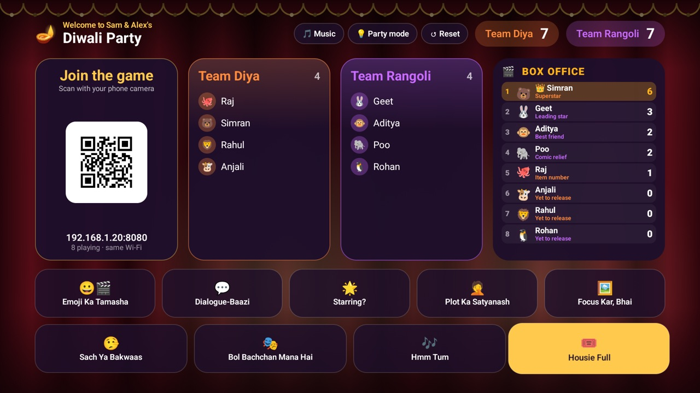</p>

| Game | How it plays | Players |
|---|---|---|
| **Emoji Ka Tamasha** | Name the film from its emojis | 2–16 |
| **Dialogue-Baazi** | Name the film from a famous line | 2–16 |
| **Starring?** | Name the film from its cast | 2–16 |
| **Plot Ka Satyanash** | Name the film from a terrible plot summary | 2–16 |
| **Focus Kar, Bhai** | Pick the film as a blurred image sharpens. Earlier is worth more | 2–16 |
| **Sach Ya Bakwaas** | Write a fake answer, then spot the true one | 3–12 |
| **Bol Bachchan Mana Hai** | Dumb charades, with the film shown on the actor's phone | 4–16 |
| **Hmm Tum** | Hum the song, no words | 4–16 |
| **Housie Full** | Tambola, with traditional calls and tickets on phones | 2–16 |

Also included: team and player scores, an animated leaderboard, difficulty-based points, rules cards, and a jukebox that controls Spotify on the TV with a Now Playing display.

<p align="center">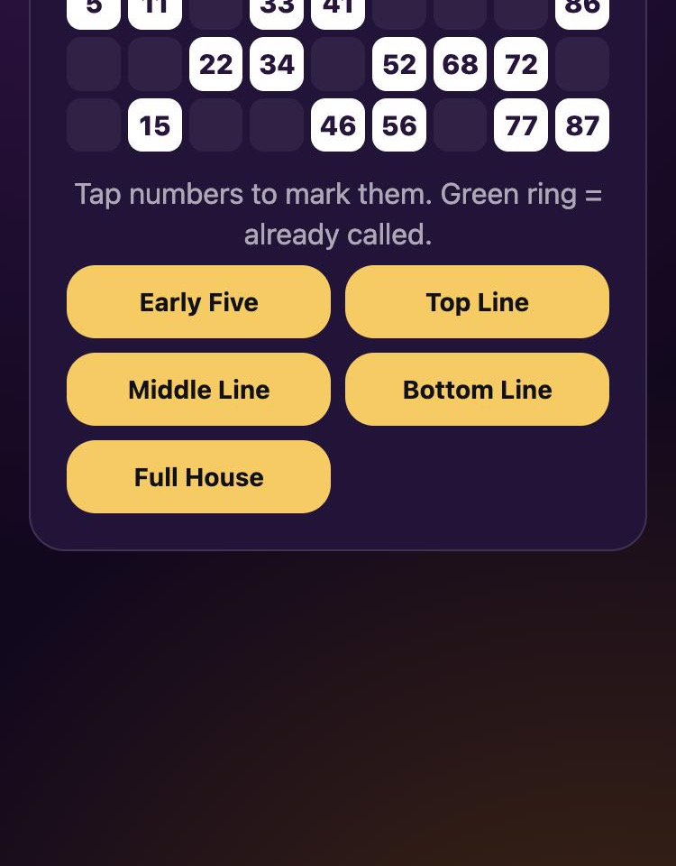</p>

<table>
<tr>
<td>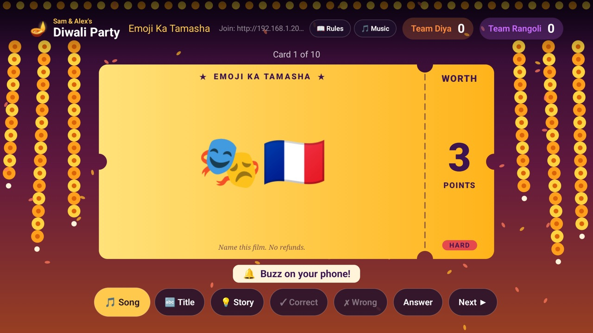</td>
<td>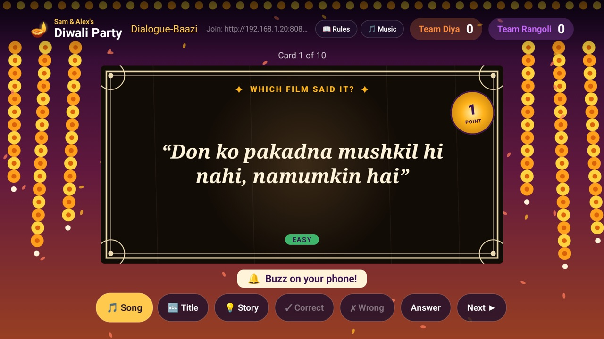</td>
<td>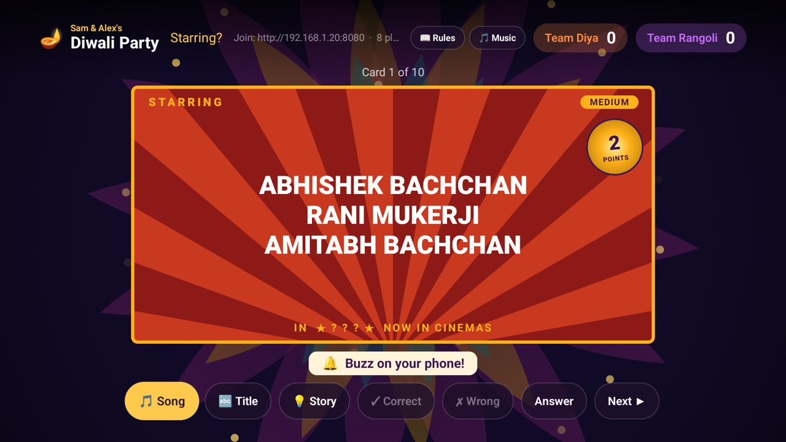</td>
</tr>
<tr>
<td>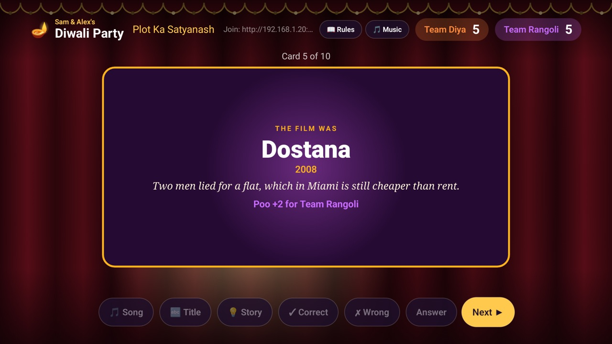</td>
<td>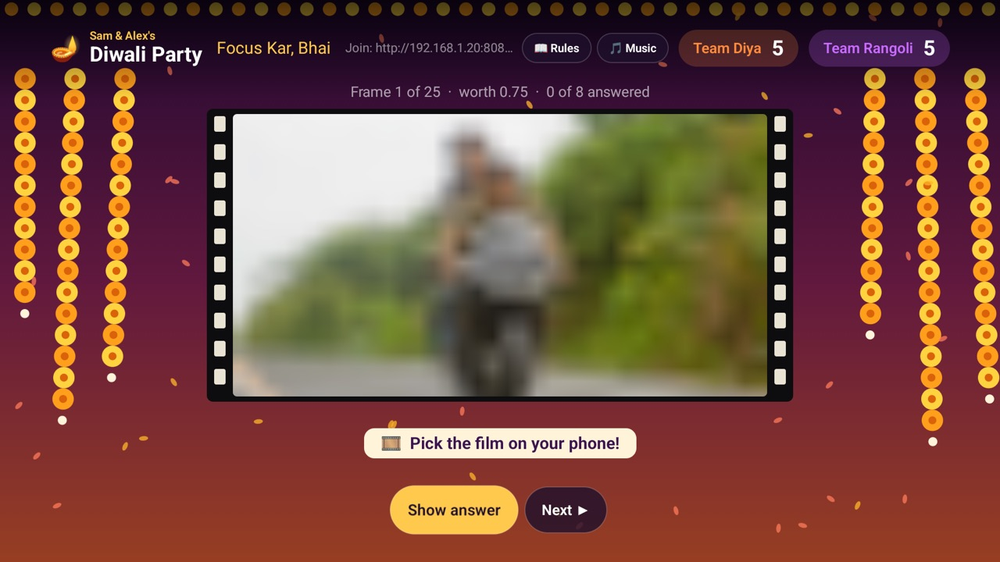</td>
<td>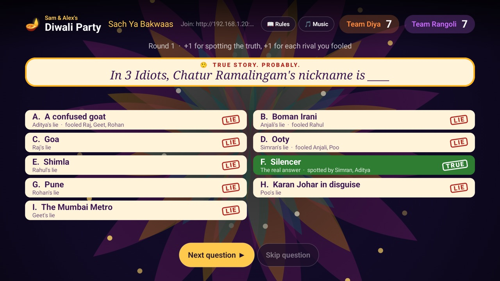</td>
</tr>
<tr>
<td>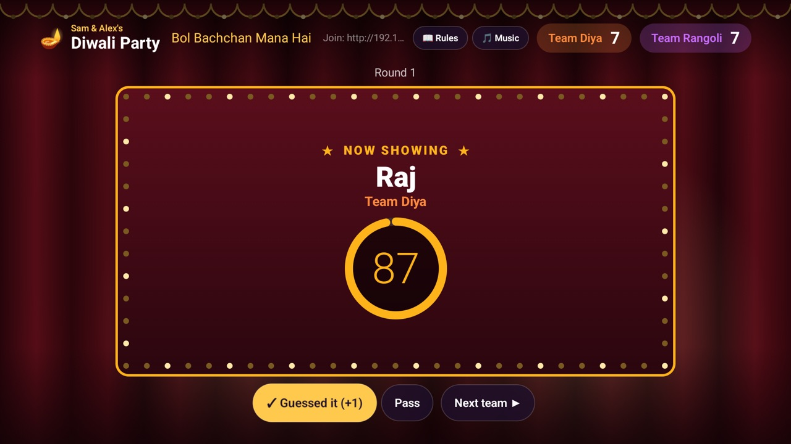</td>
<td>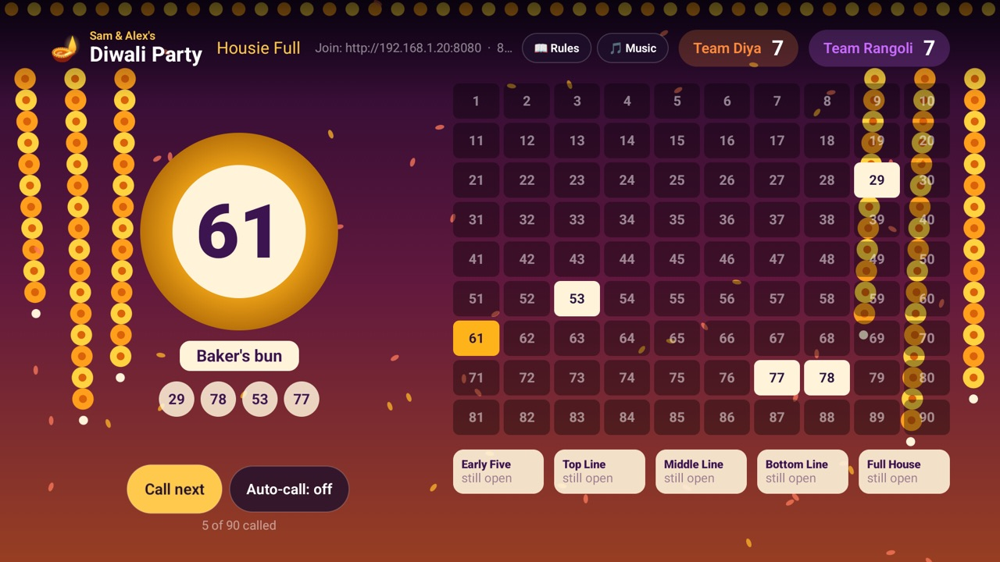</td>
<td>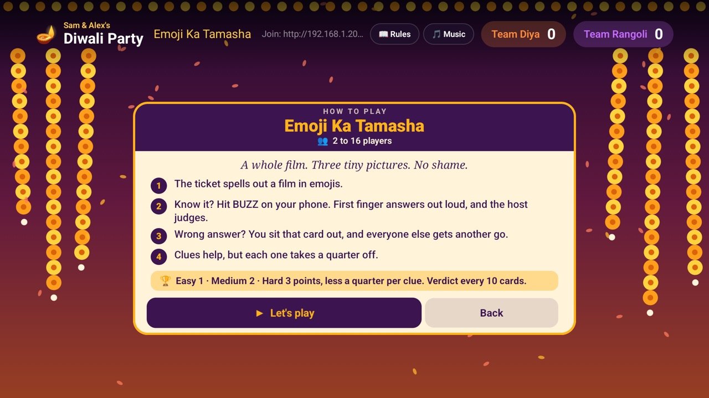</td>
</tr>
</table>

All the film content is Bollywood, so the party suits people who know Hindi cinema. A general house party mode with other content may come later.

Film trivia, plots and dialogues were written from memory, so some details may be wrong. Corrections are very welcome.

## Permissions and privacy

Glasshouse has no account, analytics or server of its own. It asks for more access than a typical app, so here's why.

| Access | Why | Worth knowing |
|---|---|---|
| Accessibility | Handle remote buttons, and read your words off Google's voice panel to pass them to Jarvis | It can see that panel's text. It's only switched on by you |
| Notification access | See what's playing, for Continue watching and music | Saved only on the TV. It doesn't read your notifications |
| Local network | The phone remote and party pages | Plain HTTP on your own Wi-Fi. The remote needs a PIN; the party page doesn't |

Data leaves your TV in these cases:
- **TMDB, Wikidata, IMDb and Open-Meteo:** film data, links, ratings and weather
- **Google Gemini:** what you ask Jarvis, along with titles you've liked
- **YouTube:** the title and channel of a video in Continue, looked up on its results page to find the link
- **Govee:** light commands

Your API keys are compiled into the app, so **don't share your built APK**.

## Undo everything

```bash
scripts/debloat.sh --undo
scripts/restore-google-tv.sh YOUR-TV-IP:5555
adb uninstall com.cleantv.launcher
```

The first line re-enables what the debloat script disabled, using the `debloat-disabled.txt` it saved in your copy of the repo, so keep that file. The restore script (Git Bash on Windows) turns Google TV's home back on and sets it as the default. Glasshouse never removes anything from your TV; it only disables Google TV's home, and only if you asked for that. Check the Home button works before you uninstall. The script is written for Google TV, so other firmware may need a different home app in it.

## Contributing

Pull requests are welcome, especially fixes, reports of other TVs working, and film content corrections. Please keep them small.

**This is a personal project, so issues may go unanswered.** If you need something changed for your TV, fork it. The code is small enough to adapt, and an AI coding agent can do most of that for you.

Never commit `local.properties` or `glasshouse.properties`.

## Credits and legal

Inspired by [CleanYourTV](https://github.com/Gathin23/cleanyourtv), which showed how much better a TV can be with the clutter gone. It covers far more TV models, so look there if yours isn't a Sony. Glasshouse is a separate project with its own code.

This product uses the TMDB API but is not endorsed or certified by TMDB. Ratings use IMDb's non-commercial datasets, for personal use. Weather is from [Open-Meteo](https://open-meteo.com). Links use [Wikidata](https://www.wikidata.org). F1 data is from [Jolpica](https://jolpi.ca), [OpenF1](https://openf1.org) and [TheSportsDB](https://www.thesportsdb.com).

Glasshouse isn't affiliated with Sony, Google, Netflix, Amazon, Spotify, Formula 1 or any other company named here. Their names and logos belong to them, and film artwork in the screenshots belongs to its owners. Changing your TV's home screen is at your own risk.

Released under the [MIT License](LICENSE).
